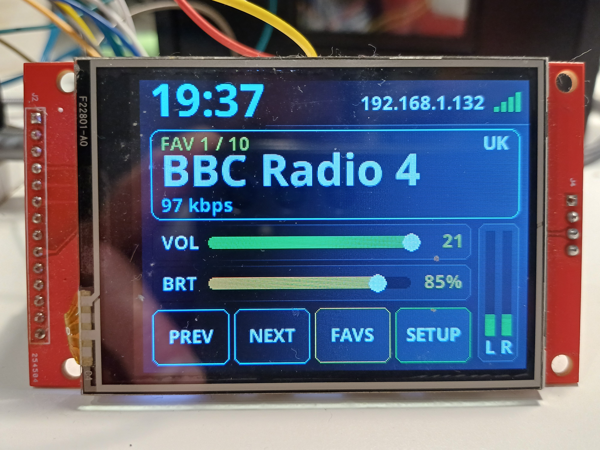
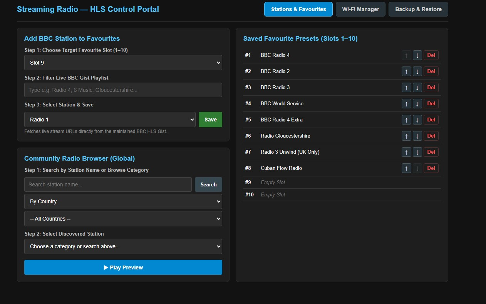

# ESP32-S3 Internet Radio (HLS + Global Community Radio)

A self-contained, SD-card-free Internet Radio built on the **ESP32-S3 N16R8** (16MB Flash + 8MB OPI PSRAM), pairing a **PCM5102A** I2S stereo DAC with a 2.8" **ILI9341** (320×240) **XPT2046** resistive touchscreen display.

---

## Core Acknowledgements & Upstream Libraries
* **Audio & HLS Engine:** Built upon Wolle's (`schreibfaul1`) **https://github.com/schreibfaul1/ESP32-MiniWebRadio** architecture and **(https://github.com/schreibfaul1/ESP32-audioI2S)** library for native BBC HLS `.m3u8` playlist parsing, circular PSRAM segment buffering, and I2S audio decoding.
* **Display & Touch Graphics:** Powered by Bodmer's ** https://github.com/Bodmer/TFT_eSPI** driving the ILI9341 SPI display with smooth anti-aliased fonts and native XPT2046 touch handling.
* **Live Stream Sources:**
  * **BBC HLS Streams:** Dynamically fetched and cached in PSRAM from **https://gist.github.com/bpsib/67089b959e4fa898af69fea59ad74bc3** so URLs stay current when BBC CDN paths change.
  * **Global Stations (Version 2+):** Powered by **https://www.radio-browser.info/** with multi-mirror failover.

---

## Version 1 (`master` / `version-1`) — BBC HLS Internet Radio
> **Focused on rock-solid BBC HLS live streaming, zero-SD-card reliability, blind first-boot setup, and full standalone + web control.**

* **Hardware Platform:** ESP32-S3 N16R8 (16MB DIO Flash, 8MB OPI PSRAM), PCM5102A I2S DAC, and 320×240 ILI9341 + XPT2046 SPI touchscreen.
* **SD-Card-Free NVRAM Storage:** Eliminates mechanical and filesystem failures from temperamental SD cards by storing up to 10 favourite presets, 10 Wi-Fi network credentials, volume level, and timezone settings directly in ESP32 NVS flash.
* **Dropout & Network Resilience:** Continuous stream-health watchdog detects stalled HLS chunks or EOF drops and automatically reconnects with controlled backoff, backed by multi-slot Wi-Fi failover across 10 saved networks.
* **Blind First-Boot Setup Beacon:** On first boot with empty NVRAM, automatically starts an open SoftAP hotspot (`BBC-Radio-Setup`) and displays setup instructions and its IP address directly on the TFT screen for phone/PC configuration.
* **Standalone TFT Touchscreen Interface:**
  * **NTP Clock & POSIX Timezones:** Variable-width `HH:MM` digital clock synced via SNTP with automatic Daylight Saving Time (DST) rules selectable on-screen, alongside live IP address and 4-bar Wi-Fi RSSI indicator.
  * **Station Card & Live Metadata:** Displays active preset badge (`FAV X / 10`), auto-sized station title, and real-time bitrate/stream metadata.
  * **Direct Touch Controls & Stereo VU Meter:** Smooth horizontal touch sliders for Volume (`VOL`) and Screen Brightness (`BRT`), `PREV` / `NEXT` / `FAVS` / `SETUP` navigation buttons, a 10-slot visual preset grid, and a real-time stereo `L`/`R` vertical VU meter.
* **Responsive Web Management Portal:**
  * **Live BBC Gist Picker & Favourites Manager:** Search/filter all live BBC national and regional streams, assign to slots 1–10, reorder (`↑` / `↓`), or delete with automatic slot compaction.
  * **Wi-Fi Manager & JSON Backup/Restore:** Scan nearby networks, manage 10 Wi-Fi slots, and download or upload a complete `.json` configuration backup.

---

## Version 2 (`version-2` / `dev`) — Full BBC HLS + Global Community Radio Browser
> **Retains all Version 1 capabilities while adding global station discovery via [radio-browser.info](https://radio-browser.info) and a non-destructive Audition, Append & Resume workflow.**

* **Global Community Radio Browser:** Inspired by Wolle's progressive category browsing in **https://github.com/schreibfaul1/ESP32-MiniWebRadio**, the web portal queries `radio-browser.info` directly with automatic mirror failover (`de2` / `fi1` / `de1`), showing codec and bitrate tags (e.g., `[MP3 128k]`, `[AAC 96k]`) across:
  * **By Country** (alphabetical A–Z with ISO country codes and station counts)
  * **By Genre / Tag**, **By Language**, and **By Codec** (MP3, AAC, AAC+, OGG, FLAC)
  * **Top Voted**, **Most Clicked**, and **Free-Text Station Name Search**
* **Temporary Audition & Resume State Machine:**
  * **Play Preview:** Temporarily tunes the radio to any discovered station without modifying saved NVRAM presets, switching the TFT station card to a highlighted **`PREVIEW`** badge with the auditioned station's title and live metadata.
  * **Append to Favourites & Resume:** Appends the auditioned station into the next empty NVRAM slot and immediately resumes the interrupted station. Includes full-slot protection that disables appending and displays a warning banner when all 10 slots are occupied.
  * **Stop & Resume:** Cancels the preview from either the web portal or TFT `PREV`/`NEXT` buttons and seamlessly returns to the interrupted favourite station.
* **Thread-Safe Deferred Stream Tuning:** Decouples HTTP web-portal tune requests from the real-time `ESP32-audioI2S` loop and extends initial connection grace windows for slow-starting HTTPS streams.

---

## Hardware & Wiring

### Components
* **Microcontroller:** `ESP32-S3-DevKitC-1-N16R8` (16MB Flash, 8MB OPI PSRAM)
* **Display & Touch:** 2.8" SPI TFT LCD (`MSP2807` / `F22801-A0`, 320×240, ILI9341 driver + XPT2046 resistive touch controller)
* **Audio DAC:** `GY-PCM5102` (PCM5102A I2S Stereo DAC with 3.5 mm line/headphone jack)
* **Storage:** SD-card-free design (all settings, Wi-Fi profiles, and presets are stored in ESP32 NVS flash)

### I2S Audio DAC Connections (`ESP32-S3` → `PCM5102A`)

| PCM5102A Pin | ESP32-S3 Pin | Notes |
| :--- | :--- | :--- |
| **VIN** | `5V` (or `3.3V`) | Power supply |
| **GND** | `GND` | Common ground |
| **DIN** | `GPIO 9` | I2S Serial Data (`I2S_DOUT`) |
| **BCK** | `GPIO 3` | I2S Bit Clock (`I2S_BCLK`) |
| **LCK** | `GPIO 1` | I2S Word Select / Left-Right Clock (`I2S_LRC`) |
| **SCK** | `GND` | Tied to GND to use internal PLL |

### Display & Touch Connections (`ESP32-S3` → `2.8" ILI9341 TFT`)

| TFT Pin (`J2`) | ESP32-S3 Pin | Notes |
| :--- | :--- | :--- |
| **VCC** | `3.3V` (or `5V`) | Power supply (check onboard regulator jumper) |
| **GND** | `GND` | Common ground |
| **LED** | `GPIO 10` | PWM Backlight control (`TFT_BL`) |
| **SCK** | `GPIO 17` | Hardware SPI Clock (`TFT_SCLK` @ 27 MHz) |
| **SDI (MOSI)** | `GPIO 18` | Hardware SPI Data Out (`TFT_MOSI`) |
| **SDO (MISO)** | `GPIO 2` | Hardware SPI Data In (`TFT_MISO`) |
| **CS** | `GPIO 8` | Display Chip Select (`TFT_CS`) |
| **DC** | `GPIO 12` | Data / Command select (`TFT_DC`) |
| **RESET** | `3.3V` (or `EN`) | Software-disabled (`TFT_RST=-1`), tied high |
| **T_CLK** | `GPIO 17` | Shared with SPI `SCK` |
| **T_DIN** | `GPIO 18` | Shared with SPI `MOSI` |
| **T_DO** | `GPIO 2` | Shared with SPI `MISO` |
| **T_CS** | `GPIO 15` | XPT2046 Touch Chip Select (`TOUCH_CS` @ 2.5 MHz) |
